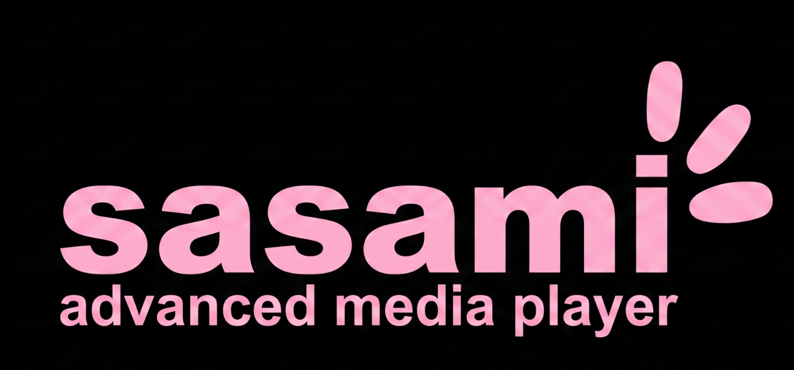

# SasamiLeaf

> "Sasami2k is, or was, the best media player ever written. Is there anything actively developed that works like it?"
> — [Ars Technica](https://arstechnica.com/civis/threads/is-there-a-spirtual-successor-to-sasami2k.483715/)

**The spirit of Sasami2K, built for modern Windows media playback.** SasamiLeaf combines a classic player interface with Flyleaf's FFmpeg and DirectX engine: local files, web streams, hardware video decoding, HDR-to-SDR tone mapping, subtitles, and detailed playback controls in a .NET 10 / WPF desktop application.

The repository includes the player, reusable Flyleaf-based .NET libraries, and media plugins. It also preserves the **original Sasami2K player under [`sasami2k-main/`](sasami2k-main/)**. The archive's launcher, documentation, and binaries are one level deeper, in [`sasami2k-main/sasami2k-main/`](sasami2k-main/sasami2k-main/).



[](https://github.com/skonester/SasamiLeaf/releases)
[](https://github.com/skonester/SasamiLeaf/releases)
[](LICENSE.txt)
[](SasamiLeaf/SasamiLeaf.csproj)
[](https://www.microsoft.com/windows)
[](https://learn.microsoft.com/dotnet/desktop/wpf/)
[](https://ffmpeg.org/)
[](https://learn.microsoft.com/windows/win32/directx)
[](https://www.nuget.org/packages/FlyleafLib)
[](https://www.nuget.org/packages/FlyleafLib)

---

## Quick Links

- **Downloads:** [GitHub Releases](https://github.com/skonester/SasamiLeaf/releases)
- **Original Sasami2K:** [Preserved player and launch instructions](sasami2k-main/sasami2k-main/README.md)
- **Comparison:** [SasamiLeaf vs. Sasami2K](#sasamileaf-vs-sasami2k)
- **Libraries:** [Technology and Dependencies](#technology-and-dependencies)
- **Upstream library packages:** [NuGet Flyleaf packages](https://www.nuget.org/packages?q=flyleaf)
- **License:** [LGPL-3.0-or-later](LICENSE.txt)
- **Upstream project:** [SuRGeoNix/Flyleaf](https://github.com/SuRGeoNix/Flyleaf)
- **Upstream documentation:** [Flyleaf Wiki](https://github.com/SuRGeoNix/Flyleaf/wiki)

## Sasami2K Origins and the Preserved Player

Sasami2K brought an unusually configurable media player to the Windows 2000 era. Its bitmap interface, aspect ratio controls, playback speeds, subtitle tools, video filters, and Winamp DSP support gave users considerable control over how their media looked and sounded.

The copy preserved here is **SASAMI2k Core #757, released August 24, 2001**, by **Ui-jong Choi ("Nuclei")**, supported by Kiwidream. Its [original English release notes](sasami2k-main/sasami2k-main/app/README_ENGLISH.TXT) identify it as an ActiveMovie2/DirectShow player. It used custom Sasami audio/video filters alongside the DirectShow decoders available on the system.

SasamiLeaf carries that emphasis on control into a separately developed application built on [Flyleaf](https://github.com/SuRGeoNix/Flyleaf). Its modern playback capabilities come from the Flyleaf, FFmpeg, and Direct3D stack; the preserved Sasami2K binaries provide the historical reference.

To run the preserved player from the repository root:

```powershell
.\sasami2k-main\sasami2k-main\SASAMI2k.cmd
```

The archive contains the original installer, extracted player and filter binaries, portable launch scripts, and tools that rebuild the portable package from the installer. Compatibility changes are documented in [PATCHES.md](sasami2k-main/sasami2k-main/PATCHES.md), with untouched binaries retained in [`original/`](sasami2k-main/sasami2k-main/original/). Its launcher handles the 32-bit DirectShow filter registration; see the [archive README](sasami2k-main/sasami2k-main/README.md) for setup, troubleshooting, provenance, and the original license terms.

## SasamiLeaf vs. Sasami2K

This comparison uses the preserved **Core #757** release as the Sasami2K baseline. SasamiLeaf entries describe the desktop application and the included Flyleaf libraries/plugins.

| Area | Sasami2K (2001, Core #757) | SasamiLeaf |
| --- | --- | --- |
| Playback engine | 32-bit ActiveMovie2/DirectShow filter graphs with custom `.ax` filters. | C# / .NET player using Flyleaf, FFmpeg, Direct3D11, and XAudio2; published as Windows x64. |
| Formats and codecs | Format support depended on installed DirectShow source filters and decoders; the release notes discuss DivX4 compatibility. | Uses the bundled FFmpeg runtime for demuxing and decoding, keeping media support with the application instead of relying on system DirectShow codec selection. |
| Video rendering | Legacy DirectShow rendering and Overlay Mixer options, with MMX optimization in its video filter. | Direct3D11 rendering, hardware decoding, GPU video processing, pixel shaders, and zero-copy paths. |
| Picture controls | Brightness, levels, sharpening, smoothing, flip, supersampling, and aspect ratio controls. | Aspect ratio, crop, pan, zoom, rotation, flips, video filters, HDR-to-SDR tone mapping, and supported NVIDIA/Intel super resolution. |
| Playback navigation | Seeking, playlists with repeat/shuffle, and normal, slow, and fast playback speeds. | Speed control, reverse video playback, frame stepping, chapter navigation, recording, snapshots, and low-latency configuration. |
| Streaming and capture | Network buffering controls and WDM capture support through its DirectShow environment. | FFmpeg network streams and capture inputs, HLS live seeking, web media through yt-dlp, and torrent streaming through BitSwarm. |
| Subtitles | SMI/S2K subtitle workflow, a bundled translator, and subtitle appearance controls. | Embedded/external text and bitmap subtitles, timing adjustments, language priorities, encoding conversion, and an online subtitle plugin. |
| Audio | Equalizer, reverb, amplification, channel effects, and Winamp DSP plugins. | FFmpeg audio decoding/filters, XAudio2 output, output-device selection, stream/language selection, volume, and audio delay controls. |
| Interface and settings | Bitmap skin assets, localized menus, keyboard controls, and INI settings beside the player. | WPF controls and templates, classic menu styling, DPI-aware hosting, fullscreen/idle behavior, and JSON configuration under `%APPDATA%\SasamiLeaf`. |
| Extensibility | Winamp `dsp_*.dll` plugins and the original filter/plugin system. | Managed plugins for media opening, stream selection, subtitles, torrents, and web media, plus reusable playback and WPF libraries. |
| Distribution | Original installer; this repository adds a preservation launcher, documented compatibility patches, and reproducible archive tooling. | Self-contained .NET x64 publishing, bundled FFmpeg/plugins, Inno Setup packaging, and automated GitHub releases with SHA-256 checksums. |

Sasami2K's capabilities above are documented in its [release notes](sasami2k-main/sasami2k-main/app/README_ENGLISH.TXT), [English UI strings](sasami2k-main/sasami2k-main/app/Languages/English.ini), [default settings](sasami2k-main/sasami2k-main/app/SASAMI2k.default.ini), and [Winamp DSP instructions](sasami2k-main/sasami2k-main/app/Plugins/README_PLUGINS.TXT).

### How SasamiLeaf Advances the Design

1. **A modern media engine.** Bundled FFmpeg libraries handle media parsing and decoding directly. This makes playback independent of which DirectShow decoder Windows selects for a file.
2. **More capable GPU processing.** The Direct3D11 renderer adds hardware decoding, HDR-to-SDR tone mapping, double-rate deinterlacing, shader processing, and vendor super resolution where supported.
3. **Broader streaming workflows.** Direct media URLs, HLS live seeking, yt-dlp web extraction, and torrent playback extend the original player's network streaming capabilities.
4. **More precise playback tools.** Reverse video, frame stepping, chapter seeks, snapshots, recording, and subtitle/audio timing adjustments support both casual viewing and close inspection.
5. **An engine other applications can use.** The playback library, WPF host, media element, and plugin interfaces let developers embed and customize the same technology in their own software.

Hardware decoding and GPU enhancements depend on the GPU, driver, media format, and selected video processor. Format support follows the bundled FFmpeg build; web and online subtitle plugins also depend on their external services. The managed plugin system is separate from Sasami2K's Winamp DSP interface.

## Highlights

- **Broad media support:** Audio, video, images, playlists, capture devices, network streams, and plugin-backed protocols.
- **GPU processing:** Direct3D11 video acceleration, HDR-to-SDR tone mapping, deinterlacing, and shader support.
- **Detailed controls:** Play, pause, stop, seek, frame stepping, reverse video, stream switching, recording, and snapshots.
- **WPF friendly:** DPI-aware `FlyleafHost` and a ready-to-style `FlyleafME` media element.
- **Extensible:** Custom I/O streams, protocol handlers, subtitle conversion, online subtitle search, torrent playback, and yt-dlp integration.
- **Self-contained distribution:** Windows x64 packages include the .NET runtime, FFmpeg, and plugins.

## Technology and Dependencies

The versions below are declared in this checkout's project files. SasamiLeaf's application version and the Flyleaf library versions are tracked separately.

| Component | Library / target in this repository | Role |
| --- | --- | --- |
| Desktop application | [SasamiLeaf](SasamiLeaf/SasamiLeaf.csproj) **2.0.2**, `net10.0-windows` | WPF player application with WinForms tray integration. |
| Playback library | [FlyleafLib](FlyleafLib/FlyleafLib.csproj) **3.10.3**, `net8.0-windows` / `net10.0-windows` | Playback state, demuxing, decoding, rendering, audio, playlists, and plugin APIs. |
| WPF media controls | [FlyleafLib.Controls.WPF](FlyleafLib.Controls.WPF/FlyleafLib.Controls.WPF.csproj) **1.6.3**, `net8.0-windows` / `net10.0-windows` | `FlyleafME`, media bar, settings, subtitle presentation, and themes. |
| Native media | [FFmpeg runtime DLLs](FFmpeg/) and Flyleaf.FFmpeg.Bindings | The app declares bindings **8.0.1**; the core library declares **7.1.1**. Published builds copy the runtime DLLs from `FFmpeg/`. |
| DirectX interop | Vortice.Direct3D11, DirectComposition, D3DCompiler, MediaFoundation, and XAudio2 **3.7.6-beta**; Vortice.Mathematics **1.9.3** | Windows graphics/video interop, shader compilation, and audio output. |
| UI dependencies | MaterialDesignThemes **5.3.1-ci1146**, Dragablz **0.0.3.234**, WpfColorFontDialog **1.0.8** | Controls, themes, draggable tabs, and font/color selection. |
| Torrent engine | [BitSwarm](Plugins/TorrentBitSwarm/TorrentBitSwarm.csproj) **2.4.12** | Torrent-backed media streams. |
| Web media tools | [YoutubeDL plugin](Plugins/YoutubeDL/), **yt-dlp**, and **Deno** | Resolves supported web pages into playable media streams; the plugin bundles the external tools. |
| Subtitle plugins | [SubtitlesConverter](Plugins/SubtitlesConverter/) and [OpenSubtitlesOrg](Plugins/OpenSubtitlesOrg/) | Subtitle charset detection/UTF-8 conversion and online subtitle search/download. |
| Packaging | `dotnet publish`, Inno Setup, and [GitHub Actions](.github/workflows/release.yml) | Self-contained Windows installers and release automation. |

The Sasami2K archive uses its own legacy runtime components: `sasami2k.exe`, `Sasami.ax`, `Sasami4a.ax`, `Sasamiv4a.ax`, `Sasami2000_Translator.exe`, and the CBT hook DLL. These are preserved separately from SasamiLeaf's playback stack. The archive's PowerShell/Python scripts and vendored UPX support portability and reconstruction of that historical package.

## Build From Source

Requirements:

- Windows with the .NET 10 SDK and Windows desktop build support.
- The bundled native DLLs in `FFmpeg/`.
- Internet access for NuGet restore and the web playback tools on the first build.
- Inno Setup 6, if you want to compile an installer.

The current SasamiLeaf app version is **2.0.2**. The Flyleaf library versions are tracked separately. Tagged release builds use the tag's version for the application and installer.

Build the app:

```powershell
dotnet build SasamiLeaf\SasamiLeaf.csproj
```

Build the full solution before publishing so all plugins are available. The application and plugins use .NET 10; this command also selects .NET 10 for the libraries that target both .NET 8 and .NET 10:

```powershell
dotnet build SasamiLeaf.sln -c Release -p:TargetFrameworks=net10.0-windows
```

Publish a self-contained Win-x64 build:

```powershell
dotnet publish SasamiLeaf\SasamiLeaf.csproj -c Release -r win-x64 --self-contained true -p:PublishSingleFile=false -o publish_out
```

Compile the standalone installer from the published output (with Inno Setup's `ISCC.exe` on `PATH`):

```bat
ISCC.exe SasamiLeaf_Standalone.iss
```

This creates `SasamiLeaf_Standalone_Setup.exe`. The older `Build_Installer.bat` publishes to `publish_out` and prints instructions for the separate legacy `SasamiLeaf_Installer.iss`, which produces `SasamiLeaf_Setup.exe`.

The YoutubeDL project invokes [`tools/Get-WebPlaybackTools.ps1`](tools/Get-WebPlaybackTools.ps1) to fetch yt-dlp and Deno when the cached tools are missing. It verifies the upstream SHA-256 hashes and retains license notices alongside the executables.

## Automated Releases

The [release workflow](.github/workflows/release.yml) builds a self-contained Windows x64 application with .NET 10, includes the plugins and bundled FFmpeg libraries, and compiles `SasamiLeaf_Standalone.iss` with Inno Setup. It publishes `SasamiLeaf_Standalone_Setup.exe` and `SHA256SUMS.txt` to GitHub Releases using the built-in `GITHUB_TOKEN`; no extra secret is needed.

Create and push an unused version tag on the commit to release, for example:

```powershell
git tag v2.0.3
git push origin v2.0.3
```

Tags must use `vMAJOR.MINOR.PATCH`, with no dot after `v`. A suffix such as `v2.1.0-beta.1` creates a prerelease.

To release directly from GitHub, open **Actions > Build and release Windows installer > Run workflow**, select `master`, and enter a new tag such as `v2.0.3`. The workflow builds the selected commit and creates the tag and release only after the installer builds successfully; the tag does not need to exist first.

To rerun an existing version, select that version's tag in **Run workflow** and enter the same tag as the input. Rerunning the same commit replaces its installer and checksum assets while preserving the existing release notes. The workflow rejects an existing tag pointing to a different commit.

The standalone installer retains its existing application ID for upgrades from SasamiLeaf 2.0. Its local default version is 2.0.2; CI overrides it from the tag. The older `SasamiLeaf_Installer.iss` is a separate legacy installer and is not used by this workflow.

## Project Layout

| Path | Purpose |
| --- | --- |
| `SasamiLeaf/` | WPF desktop player application. |
| `FlyleafLib/` | Core media playback library. |
| `FlyleafLib.Controls.WPF/` | WPF controls and media element integration. |
| `Plugins/` | Optional protocol, subtitle, torrent, and web media plugins. |
| `FFmpeg/` | Runtime FFmpeg binaries used by published builds. |
| `sasami2k-main/sasami2k-main/` | Preserved original Sasami2K player, installer, launcher, compatibility patches, and archive tooling. |
| `Images/` | Repository images and package assets. |
| `tests/YoutubeDL.Tests/` | Regression checks for web media format and audio selection. |
| `tools/Get-WebPlaybackTools.ps1` | Downloads and verifies the bundled yt-dlp and Deno tools. |
| `Build_Installer.bat` | Publishes the app into `publish_out`. |
| `SasamiLeaf_Standalone.iss` | Standalone Inno Setup installer used by release automation. |
| `SasamiLeaf_Installer.iss` | Legacy Inno Setup installer definition. |

## Feature Overview

These capabilities span the desktop player, included libraries, and optional plugins. Library APIs provide additional integration points for custom applications.

### Playback

- Open, play, pause, stop, seek, and stream switch.
- Speed control, reverse playback, low-latency modes, and zero-latency modes.
- Seek backward/forward by short or large steps.
- Seek to time, frame, or chapter.
- Frame stepping.

### Video

- Enable or disable video streams.
- Device preference selection.
- Keep, fill, or custom aspect ratio modes.
- Deinterlacing, including double-rate support with D3D11VP.
- HDR-to-SDR conversion with Aces, Hable, and Reinhard tone mapping.
- Pan, move, zoom, rotate, horizontal flip, vertical flip, and cropping.
- Recording and snapshots.
- NVIDIA and Intel super resolution support through D3D11VP.
- Video acceleration, video filters, video processors, VSync, zero-copy rendering, split-frame, and alpha packing.

### Audio

- Enable or disable audio streams.
- Device preference selection.
- Audio delay adjustment.
- Volume up, down, and mute.
- System language priorities for audio streams.

### Subtitles

- Enable or disable subtitle streams.
- Subtitle delay adjustment.
- Bitmap subtitle support.
- Advanced character detection and UTF-8 conversion through the SubtitlesConverter plugin.
- System language priorities for subtitle streams.

### FFmpeg

- HLS live seeking.
- Capture devices using compact URLs such as `fmt://gdigrab?desktop&framerate=30`.
- Custom I/O streams for application-provided media sources.
- Native FFmpeg runtime packaged alongside the player.

### Desktop Behavior

- Click the video surface to toggle playback.
- Title/status bars hide in fullscreen, with inactivity-driven fading.
- Single-instance activation and tray controls in the default release configuration.
- Application, engine, player, and UI settings stored under `%APPDATA%\SasamiLeaf`.
- Image viewing and slideshows alongside video playback.

### UI Controls

`FlyleafHost`:

- Attach and detach.
- Activity and idle modes.
- Drag move, drag-and-drop swap, and drag-and-drop open.
- Fullscreen and normal screen modes.
- Resize with optional aspect ratio preservation.
- Z-order control.

`FlyleafME`:

- WPF media element control.
- Media bar, slider, popup menu, and settings dialog.
- Material Design based color themes.
- Style and control template customization.

### Plugins

- **OpenSubtitlesOrg:** Search and download online subtitles.
- **SubtitlesConverter:** Detect subtitle encoding and convert input text to UTF-8.
- **TorrentBitSwarm:** Stream media from torrents before the full download completes.
- **YoutubeDL:** Resolve supported web pages into playable streams using yt-dlp, with bundled Deno support.

### Library Uses

- Embed a hardware-accelerated media surface in a WPF app.
- Use the player implementation as a ViewModel with `PropertyChanged` and observable collection notifications.
- Build an audio-only player without hosting a video surface.
- Download, remux, or extract frames from supported media.
- Customize mouse and keyboard bindings for embedded or custom actions.

## Credits

SasamiLeaf's playback engine and reusable controls are based on [SuRGeoNix/Flyleaf](https://github.com/SuRGeoNix/Flyleaf). The original Sasami2K player and design inspiration are credited to Ui-jong Choi ("Nuclei") / Kiwidream.

Playback dependencies:

- [FFmpeg](https://ffmpeg.org/)
- [Flyleaf.FFmpeg.Bindings](https://github.com/SuRGeoNix/Flyleaf.FFmpeg.Generator)
- [Vortice.Windows](https://github.com/amerkoleci/Vortice.Windows)

Additional upstream acknowledgments:

- [FFmpeg.AutoGen](https://github.com/Ruslan-B/FFmpeg.AutoGen/)
- [VLC](https://github.com/videolan/vlc), [Kodi](https://github.com/xbmc/xbmc), [MPV](https://github.com/mpv-player/mpv), [MPC-BE](https://github.com/Aleksoid1978/MPC-BE), and [FFplay](https://github.com/FFmpeg/FFmpeg/blob/master/fftools/ffplay.c)

UI:

- [Dragablz](https://github.com/ButchersBoy/Dragablz)
- [MaterialDesignInXamlToolkit](https://github.com/MaterialDesignInXAML/MaterialDesignInXamlToolkit/)
- [WpfColorFontDialog](https://www.nuget.org/packages/WpfColorFontDialog)

Plugins:

- [BitSwarm](https://github.com/SuRGeoNix/BitSwarm)
- [OpenSubtitles.org](https://www.opensubtitles.org/)
- [yt-dlp](https://github.com/yt-dlp/yt-dlp)
- [Deno](https://github.com/denoland/deno)

## Licensing

The Flyleaf-based code is provided under [LGPL-3.0-or-later](LICENSE.txt). Bundled third-party components retain their own licenses and notices.

The **preserved Sasami2K player has separate original terms**. Its About text states that it is free for non-commercial purposes; see the [archive's license and attribution](sasami2k-main/sasami2k-main/README.md#licence--attribution). The repository's LGPL license does not relicense those historical binaries.
